# djvj

Automated, audio-reactive generative visuals for a solo DJ set: one laptop, one big screen behind you, almost no hands-on control. Free, local, offline.

Runs in the browser (Chrome): WebGL shaders driven by live audio analysis. Everything is generated, so there is no content to license.

> **Status: phase 3.** Audio in → beat tracking and song structure → 10 beat-synced scenes plus 4 live-camera scenes, crossfaded by a director that follows builds, drops and breakdowns, with automatic palettes, texts that move with the music and take on each scene's look, an optional name/logo, a flash guard and adaptive resolution. Feedback trails, particles and MIDI come next, see [docs/DESIGN.md](docs/DESIGN.md).

## Quick start

```bash
npm install
npm run dev          # http://localhost:5173
```

1. Open **`/`**. That is the control view; it opens the output window as a popup by itself. If the browser blocks the popup, click *Open output window* (or press **`O`**), and allow pop-ups for the site to make it automatic.
2. Drag the output window onto the big screen, click once in it to allow audio input, then press **`F`** for fullscreen.
3. Pick the audio input, scenes and palette in the control view.
4. No audio yet? Press **`M`** for a simulated 128 BPM track: a groove, then every 60 s a breakdown that builds into a drop.

For a window without browser chrome, install it from Chrome (address bar → *Install djvj*). The control view then behaves like a desktop app.

There is one `index.html`: `/` is the control view and `/?view=output` the output view. Reloading the control view never reloads a running output window.

For a gig, build once and serve the static files locally (no internet needed):

```bash
npm run build && npm run preview
```

## Scenes

Ordered from calm to intense. The energy range is what the phase 2 director will use to pick scenes for builds, drops and breakdowns.

| Preview | Scene | Look | Energy |
| --- | --- | --- | --- |
| 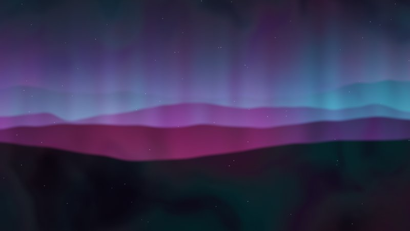 | Aurora | slow curtains of light under faint stars | calm |
| 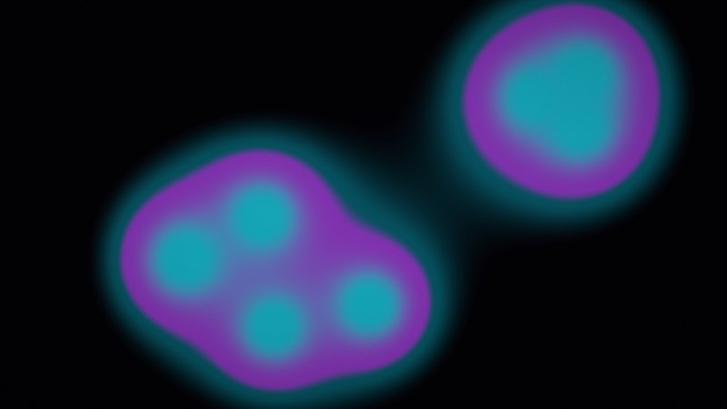 | Lava | glowing blobs that merge and split | calm to mid |
| 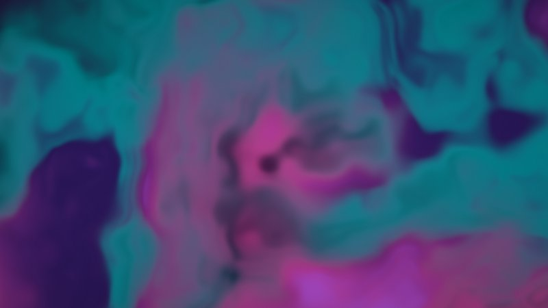 | Fluid | domain-warped noise (also the idle scene) | calm to high |
| 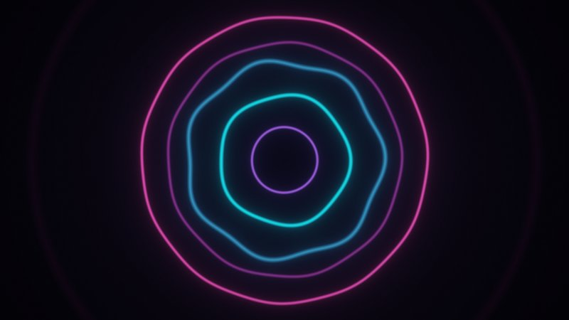 | Rings | one ring per frequency band | low to high |
| 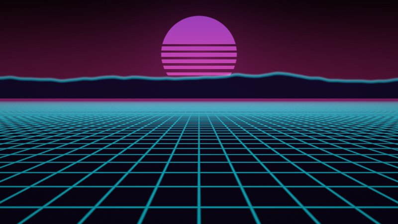 | Grid | retro perspective floor, striped sun, mountains | mid to high |
| 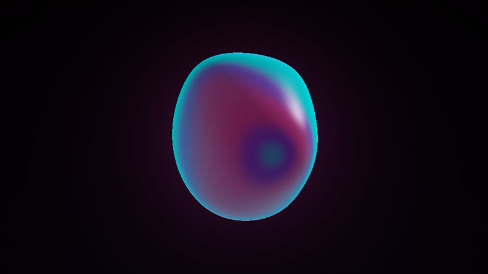 | Orb | raymarched sphere deformed by the bass | mid to high |
| 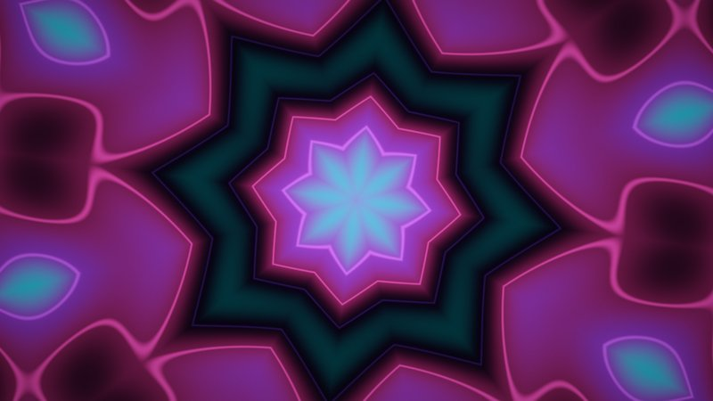 | Kaleidoscope | folded wave pattern, kicks pulse the zoom | mid to high |
| 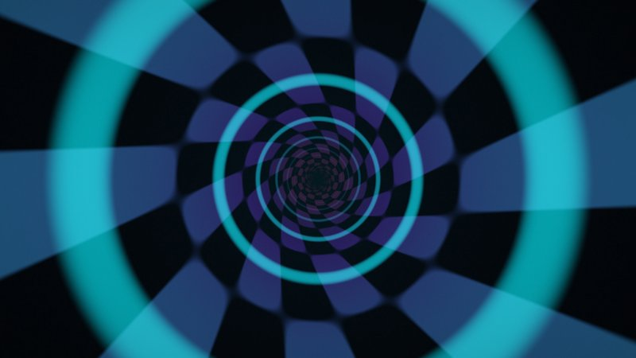 | Tunnel | checkered tunnel, speed follows the music | mid to peak |
| 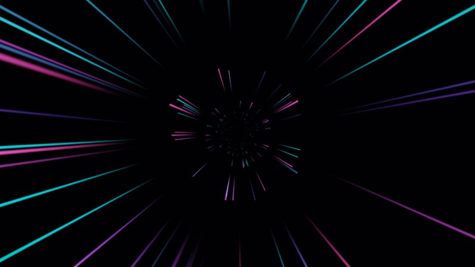 | Starfield | streaks out of the centre, longer with energy | high to peak |
| 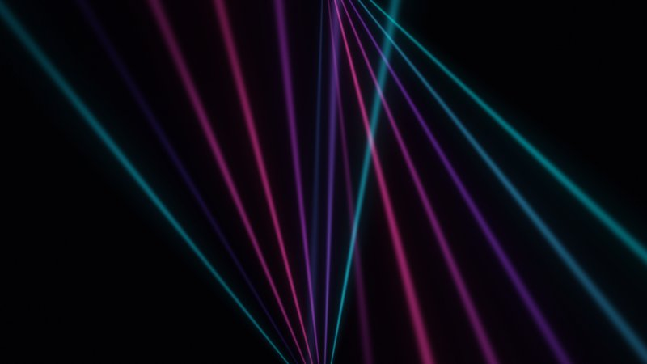 | Lasers | two fans of beams, soft pulses (no strobing) | high to peak |

### Camera scenes

Point a camera at yourself and the decks, and four more scenes put you into the visuals. They only rotate in while a camera is live, never two in a row, and keys `Q` `W` `E` `R` pick them.

| Scene | Look | Energy |
| --- | --- | --- |
| Halftone | the camera as a rotated grid of palette-coloured dots; beats swell them | low to high |
| Glyphs | falling columns of symbols; where the camera is bright, you appear inside the rain | mid to high |
| Neon edges | glowing outlines of whatever the camera sees, over a dim copy of the image | mid to peak |
| Glitch | palette-mapped camera, colour fringes on the bass, slices that slip on the kick | high to peak |

Turn it on in the control window's *Camera* card (the output window asks for camera access once).

- **Which camera.** *Automatic* uses an iPhone via **Continuity Camera** if one is around (never its Desk View camera), otherwise the default webcam. Any USB camera can be picked too. Continuity Camera is far better in a dark booth than the MacBook webcam.
- **Light.** A small LED light on you makes the biggest difference. The scenes also lift a dark image themselves (auto gain from the frame's average) and blur away sensor noise before they draw outlines, but they cannot invent detail that is not there.
- **Mirror** is off by default, so the audience sees you and the text on your gear the right way round.
- **When the camera goes away** (iPhone taken off, cable pulled) the director leaves a camera scene on the next beat and the camera is retried every 2 s. A camera scene picked by hand without a camera shows a generated stand-in figure instead of black.
- The image stays on the laptop: it is never recorded or sent anywhere.

## Rhythm and structure

djvj listens for the kick and follows the music on its own:

- **Tempo and beat grid.** It finds the BPM (115–160, tuned for techno, electronic and trance) and locks a beat grid onto the kick. An off-beat bassline does not fool it. Every scene pulses on the beat.
- **Sections.** It recognises **groove**, **breakdown** (the bass leaves), **build-up** (the highs rise without bass) and the **drop** (the bass comes back).
- **Director.** In a groove it changes scene every 64 beats (~30 s at 128 BPM). A breakdown gets a calm scene, a build a mid-energy one, and the drop an instant cut to a peak scene. Changes land on the beat and crossfade over a bar. Without a beat lock it falls back to a 45 s timer.
- **Palettes.** With *Auto palette* on, a new palette comes with every drop and every third phrase, blended over a second. Picking a palette by hand locks it.
- **Tap tempo.** If the Rhythm card never locks (a quiet mic, an unusual track), tap four times on the kick with **`T`** or the Tap button. The tapped tempo and phase stay, fine-tuned by the kicks, until *Back to auto*.
- **Rhythm card** (control window): BPM, a beat light, the current section and how well the grid is locked.
- **Beat offset.** Audio, analysis and the screen all add latency. If the pulse on the big screen trails the kick, move the slider right until it sits on it.

The kick is detected in the 40–100 Hz band. A laptop microphone hears less bass than a line input, so if the Rhythm card never locks with the mic, use a USB interface or BlackHole.

## Texts

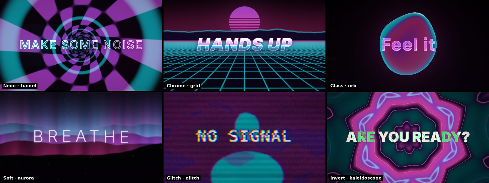

Up to eight short texts (*MAKE SOME NOISE*, *@yourhandle*, *ARE YOU READY?*) in the control window's *Texts* panel. Each one belongs to a moment of the track, and the moment decides how it moves:

| Moment | When | Motion |
| --- | --- | --- |
| **Drop** | the instant the bass comes back | slams in big with colour fringes, then pumps on the beat for 16 beats |
| **Build** | the build-up | typed out letter by letter on the beat, then grows and shakes harder as the riser climbs; the drop text takes over on the drop |
| **Break** | a bar into a breakdown | drifts in slowly, letters swaying, until the breakdown ends |
| **Groove** | now and then in a groove (every ~90 s) | letters rise in left to right, then a wave runs across them on every beat |

Several texts for the same moment take turns. **▶** next to a text shows it right away (also without music, e.g. *BACK IN 5*). **`X`** switches all texts on or off.

**Look.** Every scene has a text style that fits it, and *Auto look* follows the scene: **neon** tubes over the tunnel, lasers and rings, **chrome** over the grid and starfield, **glass** that refracts the scene over the orb, lava and fluid, **soft** glow over the aurora, **glitch** over the glitch and glyph scenes, and **invert** over the kaleidoscope and halftone. A text keeps the look it started with even when the scene changes underneath. Pick a style to use it everywhere. Colours come from the playing palette. A soft shadow behind the letters keeps them readable over busy scenes, and nothing flashes: the beat changes size, lift and glow, never the brightness of the whole text.

## Name and logo

Optional, in the control window's *Name and logo* card: a DJ name and/or a logo (a transparent PNG works best; it is scaled down and stored in this browser). Show it small in the **corner** (it steps aside while a text is on screen), or **big among the texts**: first in line after each drop and now and then in a groove, in the same looks as the texts. Off by default.

## Safety and performance

- **Flash guard.** The output's actual brightness is measured every frame (a tiny copy of the image, read back without stalling the GPU). If it flashes more than three times a second (the WCAG 2.3.1 limit), pulses are damped and the image dims slightly for a few seconds. The *flash guard* light in the Output card shows when it is active. Beat pulses up to 160 BPM stay under the limit; the guard is for the raw-kick fallback without a beat lock, which can fire on the off-beat bass too.
- **Adaptive resolution.** When frames get slow, the resolution drops in steps (to 35 % of the pixels at most) and comes back once there is headroom, so the GPU never starves rekordbox. On by default; the Output card shows when it is reducing.

## Getting audio in

The app analyses whatever input device the browser offers. It never plays the input back (no feedback).

| Source                         | How                                                                                                        | Notes                                                                                                                                                                                                                     |
| ------------------------------ | ---------------------------------------------------------------------------------------------------------- | ------------------------------------------------------------------------------------------------------------------------------------------------------------------------------------------------------------------------- |
| **MacBook microphone**         | Default. Allow microphone access for Chrome (System Settings → Privacy & Security → Microphone).           | Easiest. Hears the room, so keep the Mac near a speaker. Raise the _silence threshold_ if room noise keeps it "on".                                                                                                       |
| **USB audio interface**        | Split the controller's spare master/booth out into the interface's line-in; pick it in the control window. | Cleanest signal and independent of rekordbox. Needs a cheap interface and cable.                                                                                                                                          |
| **BlackHole** (virtual device) | Pick "BlackHole" in the control window.                                                                    | Only works if you can route audio _into_ BlackHole (e.g. a Multi-Output Device). With a Pioneer controller, rekordbox usually sends audio straight to the controller's own interface, so this may not work. Not tested.   |

Browser voice processing (echo cancellation, noise suppression, auto gain) is switched off, since it would mangle music. Input level is normalised automatically, so no gain staging is needed.

## Control view

Laptop first (three columns: preview and signal, scenes and palettes, rhythm and setup), two columns on a tablet, one on a phone. Blackout and Panic are always in the top bar; settings you set once (audio input, output quality, name and logo) are collapsed cards.

- **Preview.** A live copy of the big screen, including blackout, palette and overlay. The output only renders it while a control window is open and visible, so it costs nothing otherwise.
- **Appearance** (the half-circle button): *Dark* (default), *Light* for day gigs and *High contrast*, and an accent colour (presets or any colour). Text on the accent switches between black and white, and accent-coloured text is adjusted to stay readable. Only the control window changes; it is remembered per browser. Text contrast of every theme is checked by a test.
- **Accessibility.** Every control works from the keyboard with a visible focus ring, switches and toggle buttons announce their state, dialogs trap focus, targets are at least 44 px, and reduced motion is respected.

## Keys

Press **`?`** in the control view for the list. Single keys work in the output window and (except `F` and `D`) in the control window.

| Key       | Action                                                                     |
| --------- | -------------------------------------------------------------------------- |
| `F`       | Fullscreen (output window only)                                            |
| `O`       | Open or focus the output window (control window only)                      |
| `1`…`0`   | Pick scene 1 to 10 (same order as the pads). Locks it.                     |
| `Q` `W` `E` `R` | Pick a camera scene (Halftone, Glyphs, Neon edges, Glitch). Locks it. |
| `?`       | Shortcut list (control window only)                                        |
| `A`       | Auto-rotate scenes on/off. Picking a scene manually locks it.              |
| `N` / `C` | Next scene / next palette                                                  |
| `T`       | Tap tempo (four taps on the kick)                                          |
| `X`       | Texts on/off                                                               |
| `B`       | Blackout (fast fade to black)                                              |
| `P`       | **Panic**: instantly switch to the safe ambient scene, which ignores audio |
| `M`       | Simulated demo signal on/off                                               |
| `D`       | Debug overlay (fps, levels)                                                |

## Behaviour worth knowing

- With **no signal** and auto on, the output shows a calm idle scene instead of going dark. Scenes only change while there is music.
- Scene changes crossfade on the beat; only the drop and panic are hard cuts. A shader that fails to compile falls back to the safe scene.
- Shortcuts are ignored while typing in a text field (the DJ name, the texts), so a name with a P does not trigger panic.
- If the audio device disappears (USB unplugged), it keeps rendering and retries every 2 s.
- The output window keeps working with **no control window** open. Control only sends messages.
- Keep the output window **visible** on the second display: browsers throttle hidden windows.
- Resolution is capped at a **1080p pixel budget** (adjustable in control) so the GPU stays free for rekordbox's audio.
- Settings (device, camera, palette, brightness, resolution, auto, beat offset, overlay, texts) and the logo are remembered per browser.

## Code structure

Five layers plus the entry points. A layer may only import the ones below it; `src/architecture.test.ts` enforces this, including which packages each layer may use.

| Layer         | Responsibility                                                                                               | May use                          |
| ------------- | ------------------------------------------------------------------------------------------------------------ | -------------------------------- |
| `domain/`     | Pure logic and types: audio analysis, rhythm and song structure, scene and text directors, settings, palettes, shortcuts, message protocol, colour and theme preferences | `zod`                            |
| `services/`   | Thin adapters to browser APIs: Web Audio input, camera, `BroadcastChannel`, keyboard                         | domain                           |
| `vfx/`        | The three.js stage and the GLSL scenes                                                                       | domain, `three`                  |
| `features/`   | Use cases that wire the above together: show store, audio pipeline, output runtime, link to the control window | domain, services, vfx, `zustand` |
| `ui/`         | Presentational Preact components and styles: props in, events out, no business logic                         | domain, `preact`                 |
| `app/`        | Entry points (composition roots) and the hooks that connect UI to features                                   | everything                       |

```
src/
  domain/    audio/ (features, DSP)   camera/   rhythm/ (tempo, beat clock, sections)   show/ (scenes, director, settings)   remote/
  services/  audio-input   camera-input   message-bus   keyboard
  vfx/       stage   shader-chunks (composite: crossfade + text styles)   headline-texture   scenes/*.glsl
  features/  audio/   camera/   show/ (zustand store)   output/ (runtime)   remote/ (output-link)
  ui/        components/   control/   output/   styles/ (themes.css = colour tokens)
  app/       main.ts (picks the view)   output/   control/
```

Data flow: audio input → `FeatureExtractor` → `RhythmTracker` + `SectionTracker` (domain) → `OutputRuntime` (features) → `Director` picks the scene (domain) → `Stage` draws it (vfx). The output window owns all state; the control window sends validated patches and renders the snapshots it gets back.

**Dependencies** (each replaces code that would otherwise be hand-written): `three` renderer and context handling, `preact` UI, `zustand` state with persistence, `zod` settings types and message validation, `biome` lint and format.

**Adding a scene:** add its id to `SCENE_IDS` and an entry in `SCENES` (`domain/show/scenes.ts`, plus the text style that suits it in `SCENE_TEXT_STYLES`), and drop a `.glsl` file in `vfx/scenes/` that defines `vec3 render(vec2 uv, vec2 p)`; the compiler refuses a scene without a shader. Available uniforms are listed in `vfx/shader-chunks.ts`.

## Develop

```bash
npm test            # unit tests, including the architecture rules
npm run lint        # biome (npm run format to fix)
npm run typecheck
npm run build
```

In dev builds the output window exposes `window.__djvj.snapshot()` and `window.__djvj.inspect()` (raw features, rhythm state and section of the last frame) for diagnosing on the real rig.
